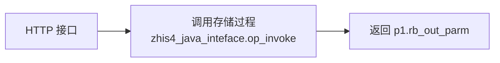

# magic-api-plugin-flow 集成流程

在 magic-api 编辑器中新增「集成流程」资源：在画布上用节点和连线配置接口，不写或少写脚本。支持五类接口：

| 场景 | 起始节点 | 说明 |
| --- | --- | --- |
| 对外 HTTP 接口 | HTTP 接口 | 地址 = `magic-api.prefix` + `magic-api.flow.http-prefix` + 分组路径 + 流程路径 |
| 对外 WebService | WebService | 地址 = `magic-api.prefix` + `/ws/服务名`，`?wsdl` 自动生成 WSDL |
| 定时推送/上传并回写 | 定时 | 分批读取 → 组报文 → 调用外部系统（HTTP / WebService / 文件 / FTP / SFTP）→ 成功/失败回写 |
| 表对表同步 | 定时 | 增量读取源库 → 写入目标表（有则更新、无则插入） |
| 消息中心 | 消息 | 院内系统推送消息（HTTP / WebService）→ 入库后立即回执 → 按类型异步消费，失败重试、死信、顺序、回调、告警，见[消息中心](#消息中心) |

任一流程中都可以用「调用存储过程」节点调用 HIS 包里的过程或函数，接口脚本中也可用 `proc` 模块，见[调用存储过程](#调用存储过程)。

流程和接口、函数一样存放在 magic-api 工作目录（`flow/` 下），参与 magic-api 的导入导出、备份、Git 同步。

## 引入

```xml
<dependency>
    <groupId>org.ssssssss</groupId>
    <artifactId>magic-api-plugin-flow</artifactId>
    <version>2.2.2</version>
</dependency>
```

依赖 `magic-api-plugin-upload`（外部连接、分批引擎、断点与运行记录），会一并引入。

| 配置 | 默认值 | 说明 |
| --- | --- | --- |
| `magic-api.flow.enable` | `true` | 关闭插件 |
| `magic-api.flow.http-prefix` | 空 | 对外 HTTP 接口前缀 |
| `magic-api.flow.soap-prefix` | `/ws` | 对外 WebService 前缀 |
| `magic-api.flow.scheduler-pool-size` | `4` | 定时流程线程数 |
| `magic-api.flow.variables-file` | `./magic-flow/variables.json` | 差异项保存位置（不在工作目录，不随配置导出） |
| `magic-api.flow.backup-dir` | `./magic-flow/backups` | 导入配置包前的全量备份目录 |
| `magic-api.flow.vars.名称` | | 差异项的默认值 |
| `magic-api.flow.record-size` | `50` | 每个流程在内存中保留的最近运行记录 |
| `magic-api.upload.secret-key` | | 外部连接密码、差异项密文的加密密钥，**生产环境必须配置** |
| `magic-api.flow.msg.*` | | 消息中心，见[消息中心](#消息中心) |

## 编辑器

- **画布**（基于 [LogicFlow](https://github.com/didi/LogicFlow) 2.x，Apache-2.0，打包进插件 js，内网离线可用）：左侧节点面板拖入或点击，从节点右侧蓝点拖出成功/条件连线，从底部红点拖出失败连线；选中节点或连线在右侧配置。先点一下画布后可用快捷键：Delete / Backspace 删除，Ctrl+Z / Ctrl+Y 撤销重做，Ctrl+C / Ctrl+V 复制粘贴；Ctrl + 滚轮缩放，拖动空白处平移，「框选」后拖出矩形多选，拖动时有对齐线；「自动排列」「适应画布」「JSON 源码」可直接编辑定义。
- **从模板生成**：HTTP 查询接口、WebService 服务、定时上传并回写、表对表同步、消息消费（查表 / 回查接口）、HTTP 调用存储过程，填几个参数生成流程骨架。
- **执行测试**（Ctrl+Q）：用编辑器中的定义（含未保存修改）真实执行一次，**会访问数据库、调用外部系统**。节点上显示执行顺序与耗时，底部「调试运行」可看每个节点的输出。
- **集成流程信息**：启用（启用后才注册 HTTP / WebService / 定时）、名称、路径、说明。
- **运行状态**：已注册的地址或 cron、注册失败原因（如路径冲突）、最近运行记录；定时流程另有断点、执行记录、失败批次，可「立即执行」「补传失败批次」「清除断点」。
- **消息中心**：各消息类型的积压、死信、回调失败数；按类型、状态、消息 id、时间查询消息，查看报文、失败时的执行轨迹、回调回执；批量「重新处理」「忽略」「重新回调」。打开消息流程时默认只看该类型。
- **集成配置**：差异项维护、配置包导出与导入。


## 消息中心

院内系统（LIS、PACS、集成平台、前置机等）把消息推送给本服务：**先入库、立即回执，再按消息类型交给流程异步处理**。对方不必等待业务处理，处理失败可以重试和追查。本服务不主动连外部，不需要部署 MQ。

一种消息类型对应一个流程，起始节点为「消息」。可以用「从模板生成 → 消息消费（查表取详情 / 回查接口取详情）」开始。

### 接收

| 方式 | 地址 | 说明 |
| --- | --- | --- |
| HTTP | `POST {magic-api.prefix}/msg/类型` | 报文 JSON / XML / 文本均可，也可以只有查询参数 `?msgId=...`；类型也可以放在 `POST /msg` 的参数、报文 `type` 字段或请求头 `X-Msg-Type` |
| 通用 WebService | `{soap-prefix}/msg`，WSDL 为 `?wsdl` | 方法 `sendMessage(type, msgId, payload)`，参数均为字符串 |
| 自定义 WebService | 按节点配置 | 兼容改不了调用方式的老系统：自定义服务名、方法名、参数名，用 `msgId` 表达式从参数或报文 XML 里取消息 id；多个类型共用一个方法时用「区分类型」表达式（如 `'hip.' + input.action`） |

收到后依次：鉴权（令牌 / IP 白名单）→ 取消息 id（默认 `input.msgId`）→ 入库 → 回执。

- 回执默认 `{"code":0,"message":"已接收","msgId":"...","duplicate":false}`（WebService 为 XML），可写回执模板。
- **去重**：同类型同消息 id 只入库一次，重复发送返回成功并带 `duplicate: true`。
- 缺消息 id 返回 400，未知类型返回 404（流程未启用时也是 404，由发送方重试），令牌错误 401，IP 不允许 403；WebService 返回 SOAP Fault。
- 令牌、`Authorization`、`Cookie` 请求头不保存到消息表。

### 消费

后台按 `poll-interval` 领取待处理消息（收到消息时立即唤醒），交给对应流程执行。流程中的 `input`：

| 变量 | 说明 |
| --- | --- |
| `input.msgId` / `input.type` | 消息 id、类型 |
| `input.payload` | 原始报文 |
| `input.body` / `input.xml` | 报文为 JSON / XML 时的解析结果；JSON 报文的字段也放在 `input` 顶层 |
| `input.params` / `input.headers` / `input.clientIp` | HTTP 查询参数或 WebService 参数、请求头、来源 IP |
| `input.attempt` / `input.receiveTime` / `input.id` | 第几次处理、接收时间、消息表主键 |

**只有消息 id 时**，流程第一步用「查库」（按 `#{input.msgId}` 查 HIS 表）或「调用外部系统」（拿消息 id 回查对方接口）取详情。查不到详情时可接「数据校验」节点让流程失败，消息会按重试规则稍后再处理（消息先到、数据后到的情况）。

- **失败重试**：流程失败（任何节点出错且没有走失败连线到正常结束）时，按 `backoff`（默认 60、300、1800 秒）等待后重试，`maxRetries`（默认 5）次后转为**死信**，在消息中心「重新处理」或「忽略」。只保存最后一次失败的执行轨迹，成功不保存轨迹。
- **并发**：每种类型 `concurrency`（默认 2），所有类型共用 `magic-api.flow.msg.threads` 个线程。
- **多台服务**：共用同一张消息表，领取是带条件的 UPDATE，同一条消息只会被一台处理。宕机、卡死时处理中超过 `processing-timeout` 的消息恢复为待重试，所以业务处理要能承受**偶尔重复执行**（如写库用「有则更新」或先判断状态）。
- **停用流程**：不再接收该类型；已入库的消息保留，重新启用后继续处理。

### 顺序消费（按类型可选）

| `order` | 说明 |
| --- | --- |
| `none`（默认） | 不保证顺序，按并发数同时处理 |
| `type` | 整个类型按接收顺序逐条处理 |
| `key` | 按分组键（`orderKey` 表达式，如 `input.body.patientId`）：同组按接收顺序，组间并发 |

前一条在等待重试时，同组后面的消息等待。前一条成为死信时：`onDead=block`（默认）阻塞该组，直到人工重新处理成功或忽略；`skip` 跳过继续。

接收顺序按入库时生成的序号（毫秒 × 1000 + 序号）。多台服务同时接收同一组消息时，顺序取决于各服务器时钟，要求严格顺序的类型请让发送方固定发往一台服务，或单机部署。

### 处理完回调（按类型可选）

`callback`：`none`（默认）/ `success` / `dead` / `both`。回调通过「外部连接」发送（HTTP / WebService，地址、签名、成功判定在外部连接中配置），报文用模板（`callbackBody`，死信可单独用 `callbackDeadBody`），可用 `msgId`、`type`、`status`（SUCCESS / DEAD）、`result`（流程返回值）、`error`、`payload`、`body`、`xml`。

```text
{"msgId": "{{msgId}}", "status": "{{status}}", "message": "{{error}}"}
```

回调状态单独记录，不影响消息本身的状态；失败按 `callbackBackoff` 重试 `callbackRetries`（默认 5）次，之后记为回调失败，可在消息中心「重新回调」。

### 告警（按类型可选）

通过上传插件的告警通道发送（日志 `magic-upload-alert`、钉钉 / 企业微信 / 飞书 / 通用 Webhook，`magic-api.upload.alert.*`），同一类型同一种告警在静默期内只发一次。

| 配置 | 说明 |
| --- | --- |
| `alertDead` | 消息成为死信 |
| `alertBacklog` | 待处理 + 待重试超过 N 条（每 `alert-interval` 检查） |
| `alertDelay` | 最早一条待处理消息超过 N 分钟 |
| `alertCallback` | 回调最终失败 |
| `alertBlocked` | 顺序消费被死信阻塞 |

### 消息表

默认和上传插件的表在同一个库（`magic-api.upload.datasource`，未配置为主数据源），首次使用时自动建表 `magic_flow_msg`（Oracle、SQL Server、H2 自动建表；其他数据库或 DBA 不允许程序建表时设 `init-schema: false` 手工建表）。索引只有三个：`(msg_type, msg_id)` 唯一、`(status, next_time)`、`(cb_status, cb_next_time)`。每天 `cleanup-cron` 清理超过 `retain-days` 天的成功、已忽略消息，死信不自动删除。

| 配置 `magic-api.flow.msg.` | 默认值 | 说明 |
| --- | --- | --- |
| `enable` | `true` | 关闭消息中心 |
| `datasource` | 空 | 消息表数据源 key，空时沿用 `magic-api.upload.datasource` |
| `table-prefix` | `magic_flow_` | 表名为 前缀 + `msg` |
| `init-schema` | `true` | 自动建表 |
| `http-path` | `/msg` | HTTP 接收地址 |
| `soap-service` | `msg` | 通用 WebService 服务名 |
| `poll-interval` | `1s` | 轮询间隔 |
| `threads` | `8` | 消费线程数 |
| `processing-timeout` | `10m` | 处理超时恢复 |
| `retain-days` | `30` | 成功消息保留天数，0 不清理 |
| `cleanup-cron` | `0 30 3 * * ?` | 清理时间 |
| `alert-interval` | `1m` | 积压、延迟告警检查间隔 |

Oracle 手工建表：

```sql
CREATE TABLE magic_flow_msg (id VARCHAR2(32 CHAR) NOT NULL, msg_type VARCHAR2(64 CHAR) NOT NULL, msg_id VARCHAR2(128 CHAR) NOT NULL,
  seq NUMBER(19) NOT NULL, order_key VARCHAR2(128 CHAR), status VARCHAR2(16 CHAR) NOT NULL, payload CLOB, meta CLOB, client_ip VARCHAR2(64 CHAR),
  attempts NUMBER(10), next_time TIMESTAMP, owner VARCHAR2(128 CHAR), lock_time TIMESTAMP, error VARCHAR2(1000 CHAR), error_node VARCHAR2(64 CHAR),
  trace CLOB, result VARCHAR2(2000 CHAR), receive_time TIMESTAMP, start_time TIMESTAMP, finish_time TIMESTAMP, cost_ms NUMBER(19),
  cb_status VARCHAR2(16 CHAR), cb_attempts NUMBER(10), cb_next_time TIMESTAMP, cb_error VARCHAR2(1000 CHAR), cb_response VARCHAR2(2000 CHAR),
  cb_time TIMESTAMP, PRIMARY KEY (id));
CREATE UNIQUE INDEX magic_flow_msg_uk ON magic_flow_msg (msg_type, msg_id);
CREATE INDEX magic_flow_msg_ix ON magic_flow_msg (status, next_time);
CREATE INDEX magic_flow_msg_cb ON magic_flow_msg (cb_status, cb_next_time);
```

SQL Server 把 `VARCHAR2(n CHAR)` 换成 `NVARCHAR(n)`、`NUMBER(19)` 换成 `BIGINT`、`NUMBER(10)` 换成 `INT`、`CLOB` 换成 `NVARCHAR(MAX)`、`TIMESTAMP` 换成 `DATETIME2`。

导出配置包时，消息触发节点上直接写的令牌导出为加密差异项 `流程路径.token`，回调用的外部连接地址导出为 `连接名.url`，各医院导入时填写。

## 调用存储过程

「调用存储过程」节点（以及脚本模块 `proc`）调用数据库里的过程或函数，按参数类型绑定入参、读取出参，适用于 Oracle 11g 及以上。对应 db-api 中「过程 + CLOB 出参」类接口，并支持多个出参、游标出参和函数返回值。



**两种写法**

- 表单（默认）：填过程名（`过程`、`包.过程`、`用户.包.过程`）和参数表，点「读取参数」按 `ALL_ARGUMENTS` 自动填写参数名、方向、类型（已填的值保留）。生成按名传参的调用 `begin pkg.p(a => ?, b => ?); end;`，值为空的入参不传，由过程使用默认值；要传空值写 `null`。填了「函数返回类型」时生成 `begin ? := pkg.f(...); end;`，返回值在 `节点id.return`。
- 手写语句：`begin pkg.p(:a, :b); end;` 或 `{call pkg.p(:a, :b)}`，`:参数名` 引用参数表。适合表单覆盖不到的情况（如先赋值再调用）。同一参数在语句中出现多次时每处单独绑定，块内要复用请先赋给局部变量。

表单下方实时显示生成的语句；过程名、参数名只允许标识符，所有值都通过绑定变量传入。

**参数**

| 配置 | 说明 |
| --- | --- |
| `name` | 参数名（表单为过程的形参名） |
| `mode` | `in`（默认） / `out` / `inout` |
| `type` | `varchar`（默认） / `number` / `integer` / `date` / `timestamp` / `clob` / `blob` / `cursor` |
| `value` | 入参值，表达式，如 `input.body`、`'getHospitalInfo'`、`q1[0].pid` |
| `parse` | 出参处理：`string`（默认，原文） / `json`（解析为对象） / `xml`（解析为 `{根元素: 内容}`） |

节点其他配置：`datasource`（空为主数据源）、`mode`（form / sql）、`name`、`sql`、`returnType`、`returnParse`、`columnCase`（游标列名，默认 lower）、`timeout`（秒）。

- `clob` 入参总是以临时 CLOB 绑定，不受 11g 的 32k 字符串限制；`date` / `timestamp` 入参可以是日期或 `yyyy-MM-dd HH:mm:ss`、`yyyy-MM-dd`、`yyyyMMdd` 等字符串。
- `cursor` 只能是出参，读取为行列表；`clob` 出参读取为字符串后按 `parse` 处理，解析失败时报出参数名和内容开头。
- 不支持 PL/SQL `BOOLEAN`、记录、集合、对象类型的参数（「读取参数」会提示），请写一个包装过程或用手写语句。
- 数据库错误原样显示，如 `调用存储过程失败：ORA-20001: 患者不存在（语句：begin pkg.p(?, ?); end;）`；接了失败连线时可用 `error.message` 返回给调用方。

**输出与返回**：节点输出为出参 Map，如 `p1.rb_out_parm`、`p1.code`、`p1.rows[0].pat_name`。返回节点写 `p1.rb_out_parm` 时原样返回报文（HTTP 接口「响应格式」选 XML / 文本 / 自动），写 `{code: 0, data: p1}` 时返回包装后的 JSON，每个接口自己选。

**脚本模块**（接口、函数中 `import proc`；原样返回用 `import response`）：

```js
import proc
import response
// 按数据库参数定义自动注册出参；没给的入参有默认值时不传
var r = proc.use('his').call('zhis4_java_inteface.op_invoke', {as_method: 'getHospitalInfo', ab_in_parm: body})
return response.text(r.rb_out_parm)

// 指定出参处理方式
proc.call('pkg.query_patient', {pid: pid}, {rb_out_parm: 'json'})
// 完整描述（格式同节点配置），如手写语句 + 游标
proc.call({mode: 'sql', sql: 'begin pkg.q(:pid, :rows); end;', params: [{name: 'pid', value: pid}, {name: 'rows', mode: 'out', type: 'cursor'}]})
// 查看参数定义
proc.arguments('pkg.query_patient')
```

在 `db.transaction(...)` 中调用时与 db 模块使用同一连接和事务；过程内部自己 `commit` 的不受影响。参数定义缓存 5 分钟，编辑器「读取参数」会刷新缓存。

**从 db-api 迁移**：db-api 中 `type=1` 的接口（语句最后一个 `?` 为 CLOB 出参）改为：HTTP 接口 → 调用存储过程（表单填过程名，点「读取参数」，入参值写 `input.参数名`，CLOB 出参处理选字符串）→ 返回 `p1.出参名`。模板「HTTP 调用存储过程」可直接生成这个骨架。
## 流程定义

```json
{
  "nodes": [
    {"id": "start", "type": "http", "config": {"method": "GET"}},
    {"id": "q", "type": "query", "config": {"sql": "select * from his_patient where patient_id = #{input.patientId}"}},
    {"id": "end", "type": "return", "config": {"value": "{code: 0, data: q}"}}
  ],
  "edges": [{"source": "start", "target": "q"}, {"source": "q", "target": "end"}]
}
```

- 起始节点：没有入线的节点，必须唯一；触发节点（HTTP / WebService / 定时 / 消息）只能是起始节点。没有触发节点的流程只能调试运行。
- 连线 `condition`：空 = 默认连线；`failure` = 节点出错时走（变量 `error`）；其他为表达式，按顺序第一个为真的生效，都不命中走默认连线。每个节点最多一条默认、一条失败连线。
- 返回节点执行后流程结束；没有返回节点时返回最后一个节点的输出。单次最多 10000 步。

### 变量

| 变量 | 说明 |
| --- | --- |
| `input` | 触发输入。HTTP：参数 + JSON 报文字段，`input.body` 原始报文，`input.xml` XML 报文解析结果，`input.headers`（小写），`input.clientIp`；WebService：各参数（字符串）；定时：`input.rows` 本批数据、`input.batch` |
| `prev` | 上一个节点的输出 |
| 节点 id | 节点输出，如 `q1[0].name`；id 不是合法变量名时用 `nodes['id']` |
| `vars` | 流程变量，脚本节点可写入 |
| `error` | 失败连线中：`{node, name, message, output}`，`output` 为出错节点的输出（如外部系统回执） |
| `row` / `index` / `item` | 逐行执行时的当前行与序号 |

### 节点

| 类型 | 名称 | 主要配置 |
| --- | --- | --- |
| `http` | HTTP 接口 | `method`、`auth`（none / token）+ `tokenHeader` + `token`、`allowIps`（支持 `192.168.1.*`）、`contentType`（auto / json / xml / text）、`errorStatus` |
| `soap` | WebService | `service`、`operation`、`params`（逗号分隔，均为字符串；参数内是未转义的 XML 时取原文）、`resultName`、`namespace`。同一 service 的流程合并为一个服务；返回对象时转为 XML 文本；失败返回 SOAP Fault |
| `msg` | 消息 | 见[消息中心](#消息中心) |
| `timer` | 定时 | `cron`（6 位）、`mode`：`once` 每次执行一次 / `pending` 每次读取全部待处理数据（适合"查未上传 → 上传 → 回写标志"）/ `keyset` 按递增字段增量、断点保留 / `offset` 分页读取全部；`sql`、`datasource`、`keyColumn`、`orderBy`、`batchSize`、`retry`、`retryInterval`、`failurePolicy`（stop / skip）、`maxBatches`、`columnCase` |
| `query` | 查库 | `sql`、`datasource`、`result`（list / one / value / count）、`columnCase`（默认 lower） |
| `write` | 写库 | `sql`、`forEach`、`transaction`（默认整批事务）、`datasource`；输出 `{affected, executed}` |
| `save` | 写入表 | `table`、`rows`、`mode`（upsert / insert / update / replace）、`keys`、`columns`、`exclude`、`transaction`、`datasource`；输出 `{inserted, updated, deleted, total}` |
| `map` | 字段映射 | `source`、`fields: [{name, value, type, format, default}]`（type：string / number / int / date / boolean）、`keepOthers` |
| `nest` | 主从组装 | `master`、`children: [{name, source, masterKey, childKey, single, removeKey}]` |
| `template` | 报文模板 | `format`（json / xml / text）、`template`：`{{表达式}}` 转义输出，`{{{表达式}}}` 原样，`{{#each list as r}}…{{/each}}`，`{{#if 条件}}…{{else}}…{{/if}}` |
| `xml` | XML 转换 | `action`（parse / build）、`source`、`path`、`root`、`itemName`、`declaration`。解析禁止外部实体 |
| `json` | JSON 转换 | `action`（parse / stringify）、`source`、`pretty` |
| `validate` | 数据校验 | `rules: [{field, rule, value, message}]`（required / maxLength / regex / expr）、`mode`（split / fail）；输出 `{valid, invalid, total, invalidCount}` |
| `call` | 调用外部系统 | `channel`（外部连接名称）、`body`、`headers` / `params`（值中可用 `{{表达式}}`）、`forEach`、`retry`、`retryInterval`、`cacheSeconds` + `cacheKey`（登录取令牌）；输出 `{success, message, request, response, data, retryable}` |
| `proc` | 调用存储过程 | 见[调用存储过程](#调用存储过程) |
| `script` | 脚本 | `script`，magic-script，可用 db、http、log 等模块 |
| `return` | 返回 | `value` 表达式 |

### 外部连接

调用节点使用上传插件的「上传通道」作为外部连接：地址、超时、固定请求头、签名器（`UploadSigner` Bean）、成功判定（`successField` / `successValues` / `messageField`）、密码加密都在连接中配置。调用节点不执行连接的报文转换脚本，报文由流程生成。

网络错误、超时、HTTP 5xx 为可重试失败；业务拒绝（成功字段不符、4xx、SOAP Client Fault）不重试。

## 定时上传的运行治理

复用上传插件的分批引擎：任务锁（多实例只有一个在跑）、断点、执行记录、失败批次、告警（`magic-api.upload.alert.*`）。

- 每批执行一次触发节点之后的流程。流程成功 = 本批成功、断点前进；流程失败 = 本批失败，按 `retry` 重试，`failurePolicy=stop` 停在这一批（下次从这里继续），`skip` 记录失败批次后继续，之后在「运行状态」中补传。
- 调用节点接了失败连线并完成回写时，流程算成功（失败已记录在业务表中，按回写标志下次重传）。
- 任务名为 `flow:` + 流程路径，修改流程路径相当于新任务。

## 差异项与配置包

各医院不同的值（对方地址、账号、机构编码、令牌等）写成 `${var.名称}` 或 `${var.名称:默认值}`，可用于节点配置、触发配置、外部连接参数。取值顺序：差异项文件 → `magic-api.flow.vars.名称` → 默认值，都没有时运行报错并提示名称。

**导出**（集成配置 → 导出配置包）：流程及其引用的外部连接打成 zip。连接的 `url`、`host`、`port`、`username`、`dir` 和密码、密钥替换为差异项 `${var.连接名.参数名}`，密码不出包。清单列出所有差异项及说明、示例值。

**导入**（集成配置 → 导入配置包）：选择 zip 后预览将新建/覆盖的流程和连接，逐项填写本院的差异项（已配置的可留空），缺项不导入。导入前自动全量备份工作目录（`backup-dir`，开启了 magic-api 备份时同时写备份记录）。同 id 或同路径的流程、同名的连接覆盖，分组按路径查找或创建。

## 验收示例

[`examples/insur-3501.json`](examples/insur-3501.json) 用流程复刻了 `magic-scripts/insur_trace/upload_3501.ms`（医保追溯码商品盘存上传）：待上传数据逐行组报文、签名、上传，成功回写状态 1，失败回写状态 0 并累计失败次数、下次重传。原脚本中 `case_interface_config` 的配置改为差异项 `gdyb.*`。`FlowAcceptanceTest` 对照脚本版验证报文字段、签名、回写和重传行为。

签名需要几行脚本（`script` 节点）；更通用的做法是实现 `UploadSigner` Bean 并在外部连接中配置 `signer`。

## 扩展节点类型

实现 `org.ssssssss.magicapi.flow.engine.FlowNodeHandler` 并注册为 Spring Bean；同名类型时 `@Order` 靠前的生效。需要出错时也留下输出，抛出 `FlowNodeException`。画布对未内置的类型以 JSON 编辑配置。

## 错误码

| 代码 | 含义 |
| --- | --- |
| 5001–5006 | 流程定义为空、JSON 格式错误、节点 id 缺失或重复、缺少类型、连线指向不存在的节点 |
| 5007 | 找不到流程 |
| 5008 | 节点类型不支持 |
| 5009 | 起始节点不唯一 |
| 5010 | 执行步数超限（可能成环） |
| 5011 / 5013 | 节点缺少必填配置 / 配置值不正确 |
| 5012 | 同一节点有多条默认连线或失败连线 |
| 5014 | 触发节点不是起始节点 |
| 5015 / 5016 | 差异项未配置 / 名称不合法 |
| 5017 | 不是定时流程 |
| 5018 | 配置包不正确 |
| 5019 | 找不到场景模板 |
| 5020 / 5021 | HTTP 地址冲突 / WebService 方法重复 |
| 5022 / 5023 / 5024 | 消息类型重复 / 消息中心未启用 / 找不到消息 |
| 5025 | 读取过程参数或生成调用语句失败（原因见提示） |
